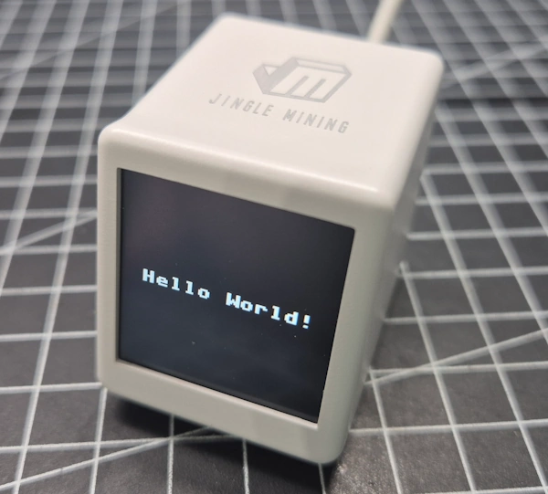

# Hello World auf dem GeekMagic SmallTV

Dieses Beispiel zeigt den Text **Hello World!** mittig in Weiß auf dem schwarzen Display des GeekMagic SmallTV. Es dient als erster Funktionstest für MicroPython, Displaytreiber und Displaykonfiguration, bevor du Bilder oder das Tokenmonitor-Dashboard ausprobierst.

## Vorschau



## Voraussetzungen

- GeekMagic SmallTV mit ESP8266 und ST7789-Display mit 240 × 240 Pixeln, passend zur unten genannten Pinbelegung.
- Installierte MicroPython-Firmware.
- Verbindung zum Gerät, beispielsweise über Thonny.
- Die in diesem Repository enthaltene Datei [`st7789py.py`](../lib/st7789py.py).

Das Beispiel bezieht sich auf den verwendeten ESP8266-Aufbau. Für andere Hardwarevarianten, insbesondere das SmallTV Pro mit ESP32, muss die Konfiguration geprüft und angepasst werden.

## Dateien übertragen

| Datei im Repository | Ziel auf dem SmallTV |
| --- | --- |
| [`helloWorld.py`](./helloWorld.py) | `/helloWorld.py` |
| [`../lib/st7789py.py`](../lib/st7789py.py) | `/lib/st7789py.py` |

Lege auf dem Gerät den Ordner `/lib` an, falls er noch nicht vorhanden ist. Die Treiberdatei muss auf dem MicroPython-Dateisystem liegen; eine Kopie auf dem Computer allein genügt nicht.

Für dieses Beispiel werden keine WLAN-Verbindung, Bilddateien oder zusätzlichen Schriftdateien benötigt. `machine` und `framebuf` werden von der MicroPython-Firmware bereitgestellt.

## Beispiel starten

1. Übertrage die beiden Dateien an die oben genannten Zielorte.
2. Öffne `/helloWorld.py` vom Gerät in Thonny.
3. Führe das Skript aus.

Das Programm löscht den Bildschirm und zeichnet **Hello World!** mit doppelter Schriftgröße in die Mitte. In der MicroPython-Shell erscheint anschließend:

```text
Displaytest ausgeführt
```

Die Anzeige bleibt nach dem Ende des Skripts auf dem Display stehen.

Für einen automatischen Start beim Einschalten kannst du das Beispiel als `/main.py` auf dem Gerät speichern. Sichere zuvor eine bereits vorhandene `main.py`, damit du kein anderes Beispiel überschreibst.

## Displaykonfiguration

Das Skript verwendet folgende Zuordnung:

| Funktion | Einstellung |
| --- | --- |
| Displayauflösung | 240 × 240 Pixel |
| SPI-Schnittstelle | Hardware-SPI 1 |
| SCLK | GPIO14 |
| MOSI | GPIO13 |
| DC | GPIO0 |
| Display-Reset | GPIO2 |
| Hintergrundbeleuchtung | GPIO5, LOW schaltet sie ein |
| CS | Kein separater Pin (`cs=None`) |
| SPI-Takt | 10 MHz |
| SPI-Modus | Modus 3: `polarity=1`, `phase=1` |

Die GPIO-Zuordnung ist im SmallTV bereits verdrahtet. Für diesen Aufbau musst du keine externen Displayleitungen anschließen.

Verwende den im Repository enthaltenen Treiber zusammen mit dem Beispiel. Dessen `ST7789.init()` unterstützt den hier verwendeten Aufruf `display.init()` ohne Argumente. Andere gleichnamige Treiberversionen können eine abweichende Schnittstelle besitzen.

## So funktioniert die Textausgabe

Das Programm erstellt mit `framebuf` zunächst ein kleines monochromes Textbild. Für die zwölf Zeichen von `Hello World!` ist dieser Puffer 96 × 8 Pixel groß und benötigt nur **96 Byte** für die Pixeldaten.

Anschließend liest das Skript die gesetzten Pixel aus und zeichnet jeden davon als weißes Rechteck mit 2 × 2 Pixeln auf das Display. Daraus entsteht eine Ausgabe mit einem Raster von 192 × 16 Pixeln, die mittig positioniert wird. Ein vollständiger RGB565-Bildpuffer ist dafür nicht erforderlich.

## Text und Größe ändern

Den angezeigten Text legst du über diese Zeile fest:

```python
text = "Hello World!"
```

Der Vergrößerungsfaktor steht in:

```python
scale = 2
```

Die Zentrierung wird aus Textlänge und Skalierung berechnet. Achte darauf, dass `len(text) * 8 * scale` nicht größer als 240 ist, damit der Text in der Breite auf das Display passt. Die eingebaute Schrift eignet sich für einfache ASCII-Texte; Umlaute werden damit nicht automatisch korrekt dargestellt.

## Fehlersuche

| Problem | Prüfen |
| --- | --- |
| `ImportError` für `st7789py` | Liegt die Datei auf dem Gerät unter `/lib/st7789py.py`? |
| Fehler bei `display.init()` | Ist die im Repository mitgelieferte Treiberversion installiert? |
| Display bleibt dunkel | Pinbelegung prüfen; die Hintergrundbeleuchtung ist bei diesem Aufbau aktiv LOW. |
| Text fehlt teilweise | Textlänge und `scale` reduzieren. |
| Keine Verbindung in Thonny | Richtigen seriellen Port und MicroPython-Interpreter für den ESP8266 auswählen. |

## Weiterführende Beispiele

- [Bilder im RGB565-Format anzeigen](../02_images/)
- [Claude-Code-Tokenmonitor](../03_ClaudeAI-Tokenmonitor/)
- [Zur Projektübersicht](../README.md)
- [Blog: Originalfirmware sichern und MicroPython installieren](https://draeger-it.blog/geekmagic-smalltv-micropython/)
