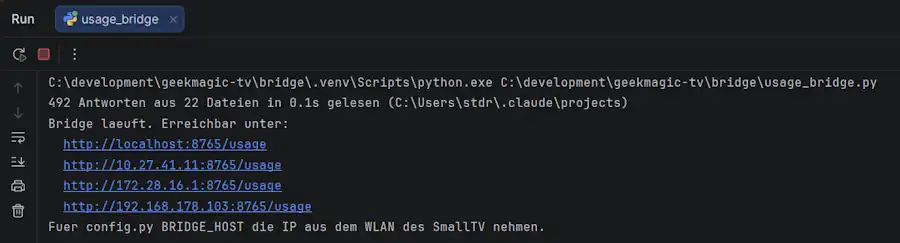

# Claude-Code-Tokenmonitor auf dem GeekMagic SmallTV

Dieses Projekt zeigt den lokal erfassten Tokenverbrauch von Claude Code auf dem GeekMagic SmallTV mit ESP8266 und MicroPython. Eine Python-Bridge auf dem PC liest die Claude-Code-Protokolle und stellt die zusammengefassten Werte als JSON über HTTP bereit. Der SmallTV ruft diese Daten im WLAN ab und zeigt sie auf seinem 240 × 240 Pixel großen Farbdisplay an.

Erfasst werden die auf diesem PC vorhandenen Claude-Code-Protokolle. Die Anzeige ist keine vollständige Verbrauchsübersicht deines Claude-Kontos: Webchat, Smartphone-App und die Nutzung auf anderen Computern werden nicht automatisch einbezogen.

## Vorschau



Die Bridge gibt beim Start die Adressen aus, unter denen die JSON-Verbrauchsdaten erreichbar sind.

## Aufbau

| Bestandteil | Aufgabe |
| --- | --- |
| Claude-Code-Protokolle auf dem PC | Enthalten die lokal aufgezeichneten Verbrauchsangaben |
| `usage_bridge.py` auf dem PC | Liest die Protokolle, fasst die Werte zusammen und liefert JSON |
| MicroPython-Programm auf dem SmallTV | Ruft die Bridge ab und zeichnet das Dashboard |
| `st7789py.py` auf dem SmallTV | Steuert den ST7789-Displaycontroller an |

Für neue Verbrauchswerte müssen der PC und die Bridge laufen. Der SmallTV muss den PC über das lokale Netzwerk erreichen können.

## Voraussetzungen

### PC

- Claude Code mit vorhandenen lokalen Gesprächsprotokollen.
- Python 3.9 oder neuer.
- Die Datei `usage_bridge.py` aus diesem Beispiel.
- Netzwerkverbindung zum SmallTV.

Die Bridge verwendet ausschließlich die Python-Standardbibliothek. Zusätzliche Pakete und ein API-Schlüssel sind dafür nicht erforderlich. Sie stellt selbst keine Anfragen an Claude.

### SmallTV

- GeekMagic SmallTV mit ESP8266 und ST7789-Farbdisplay mit 240 × 240 Pixeln, passend zur Hardwarekonfiguration des Beispiels.
- Installierte MicroPython-Firmware.
- Zum Programm passende Version von `st7789py.py` unter `/lib/st7789py.py`.
- WLAN-Verbindung mit Zugriff auf den PC.
- Beispielsweise Thonny zum Übertragen und Starten der Dateien.

Hinweise zum Treiber findest du in der [README im Verzeichnis lib](../lib/README.md). Die ESP8266-Firmware ist nicht für das SmallTV Pro mit ESP32 bestimmt.

## 1. Bridge am PC prüfen

Wechsle in den Ordner mit `usage_bridge.py` und starte zunächst die einmalige Auswertung:

```powershell
python usage_bridge.py --once
```

Das Skript zeigt die Anzahl der eingelesenen Antworten und Dateien sowie eine JSON-Zusammenfassung an.

Standardmäßig werden Dateien unter `~/.claude/projects/**/*.jsonl` ausgewertet. Unter Windows liegt das Verzeichnis normalerweise unter `%USERPROFILE%\.claude\projects`. Ist `CLAUDE_CONFIG_DIR` gesetzt, sucht die Bridge im Unterverzeichnis `projects` dieses Konfigurationsverzeichnisses.

## 2. HTTP-Server starten

```powershell
python usage_bridge.py
```

Der Standardport ist `8765`. Auf dem PC lässt sich die Antwort im Browser unter folgender Adresse prüfen:

```text
http://localhost:8765/usage
```

Die Bridge gibt beim Start außerdem mögliche lokale IP-Adressen aus. Für den SmallTV wird die Adresse des PCs im gemeinsamen Netzwerk benötigt, beispielsweise:

```text
http://192.168.178.50:8765/usage
```

Die IP-Adresse ist ein Beispiel und muss durch die tatsächliche Adresse deines PCs ersetzt werden. `localhost` funktioniert nur beim Abruf auf dem PC selbst.

Bei Bedarf lassen sich Port und Bind-Adresse festlegen:

```powershell
python usage_bridge.py --port 9000 --bind 0.0.0.0
```

Passe dann auch den Port in der SmallTV-Konfiguration an. Das Terminal bleibt während des Betriebs geöffnet. Mit `Strg+C` beendest du den Server.

Die Bridge lauscht standardmäßig auf allen IPv4-Netzwerkschnittstellen. Falls nötig, erlaube den eingehenden Zugriff in der Windows-Firewall für das verwendete private Netzwerk. Der Server verwendet HTTP ohne Anmeldung und ist für den lokalen Aufbau vorgesehen; eine Router-Portfreigabe ins Internet wird nicht benötigt.

## 3. SmallTV konfigurieren und starten

1. Trage deine WLAN-Zugangsdaten in die Konfiguration des MicroPython-Beispiels ein.
2. Setze `BRIDGE_HOST` in `config.py` auf die lokale IP-Adresse des PCs. Verwende für einen Host-Eintrag nur die Adresse, ohne `http://` und ohne `/usage`.
3. Prüfe, dass der konfigurierte Port zum gestarteten Bridge-Server passt.
4. Übertrage die zum Beispiel gehörenden MicroPython-Dateien und benötigten Zusatzdateien auf das Gerät. Das PC-Skript `usage_bridge.py` bleibt auf dem PC.
5. Kopiere den Displaytreiber nach `/lib/st7789py.py` auf dem SmallTV.
6. Starte das MicroPython-Hauptprogramm über Thonny, während die Bridge läuft.

Übernimm die Dateistruktur und weiteren Einstellungen aus dem Beispielcode. Für den automatischen Start beim Einschalten muss das Hauptprogramm als `/main.py` vorliegen oder von dort aufgerufen werden. Sichere eine bereits vorhandene `main.py`, bevor du sie ersetzt.

Veröffentliche keine echten WLAN-Passwörter in deiner GitHub-Kopie. Verwende Platzhalter für persönliche Zugangsdaten.

## JSON-Beispielausgabe

Die folgende Beispielantwort zeigt einen Tag ohne bislang erfassten Verbrauch, aber mit vorhandenen Wochen- und Monatswerten:

```json
{
  "t": "10:52",
  "today": 0,
  "in": 0,
  "out": 0,
  "cr": 0,
  "cw": 0,
  "week": 35493980,
  "month": 53333698,
  "usd": 0,
  "days": [2140887, 0, 1115565, 2084151, 19324576, 12969688, 0],
  "dl": "SSMDMDF",
  "unpriced": []
}
```

| Feld | Bedeutung |
| --- | --- |
| `t` | Aktuelle lokale Uhrzeit des PCs |
| `today` | Heutige Summe aus Input, Output, Cache Read und Cache Write |
| `in` | Heutige Eingabetoken außerhalb der gesonderten Cache-Kategorien |
| `out` | Heutige Ausgabetoken |
| `cr` | Heute aus dem Cache gelesene Token |
| `cw` | Heute für den Cache geschriebene Token |
| `week` | Token seit Montag der aktuellen Kalenderwoche |
| `month` | Token seit dem ersten Tag des aktuellen Monats |
| `usd` | Geschätzter API-Vergleichswert für den heutigen Verbrauch in US-Dollar |
| `days` | Token pro Tag für die letzten sieben Kalendertage, einschließlich heute; ältester Tag zuerst |
| `dl` | Wochentagskürzel in derselben Reihenfolge wie `days` |
| `unpriced` | Heute verwendete Modelle ohne passenden Eintrag in der Preistabelle |

`SSMDMDF` steht hier für Samstag, Sonntag, Montag, Dienstag, Mittwoch, Donnerstag und Freitag. Das letzte Element von `days` gehört zu heute. Die rollierende Sieben-Tage-Ansicht ist nicht mit der Kalenderwoche gleichzusetzen; ihre Summe muss daher nicht `week` entsprechen.

Ein heutiger Wert von `0` kann korrekt sein, obwohl bereits Wochen- und Monatsverbrauch vorliegt. Er bedeutet, dass die ausgewerteten Protokolle für heute keine gezählten Token enthalten.

## Aktualisierung und Zählweise

Beim Start liest die Bridge die vorhandenen Protokolle ein. Danach merkt sie sich die Leseposition jeder Datei und verarbeitet neu hinzugekommene vollständige Zeilen. Bei einer HTTP-Anfrage wird erneut eingelesen, wenn seit der letzten Auswertung mindestens zehn Sekunden vergangen sind. Ohne Anfragen findet keine periodische Aktualisierung statt.

Mehrere protokollierte Zwischenstände mit derselben Kombination aus Nachrichten-ID und Request-ID ersetzen den vorherigen Stand. Die Zeiträume richten sich nach der lokalen Zeitzone des PCs.

Cache-Token sind Teil der angezeigten Gesamtsumme. Die Tokenzahl umfasst deshalb mehr als nur den sichtbaren Text einer Eingabe und Antwort.

## API-Vergleichswert statt Abrechnung

`usd` wird anhand der fest im Bridge-Skript hinterlegten Modellpreise berechnet. Dieser Wert ist eine Schätzung und keine Rechnung für ein Claude-Abonnement. Prüfe die Modellnamen und Preise vor der Nutzung und halte sie bei Änderungen aktuell.

Fehlt ein Modell in der Preistabelle, werden seine Token weiterhin gezählt. Sein Kostenanteil fehlt jedoch in `usd`; der Modellname erscheint für den heutigen Tag in `unpriced`. Eine leere Liste bei gleichzeitigem Tagesverbrauch von `0` bestätigt nicht, dass alle früher verwendeten Modelle bepreist sind.

## Fehlersuche

| Problem | Prüfen |
| --- | --- |
| Keine Protokolle gefunden | Läuft die Bridge unter dem richtigen Benutzer? Stimmen Konfigurationsverzeichnis und vorhandene Claude-Code-Dateien? |
| Browser erreicht die Bridge nicht | Läuft das Skript? Stimmen Adresse und Port? Ist der Port bereits belegt? |
| PC erreicht `localhost`, SmallTV aber nicht die Bridge | PC-IP, WLAN-Verbindung, Firewall und eine mögliche Client-Isolation im WLAN prüfen. |
| Werte aktualisieren sich nicht | Bridge-Erreichbarkeit, neue Protokolle und das Abrufintervall des MicroPython-Programms prüfen. |
| Heutiger Verbrauch ist unerwartet `0` | Lokales Datum und Zeitzone des PCs sowie die tatsächlich ausgewerteten Protokolle prüfen. |
| API-Vergleichswert fehlt oder ist zu niedrig | `unpriced` und die im Skript hinterlegte Preistabelle prüfen. |
| Display bleibt dunkel | Treiberversion, Displaykonfiguration und Hintergrundbeleuchtung prüfen. |
| Fehler bei `display.init()` | Die Russ-Hughes-Treiberversion initialisiert im Konstruktor; ihr `init()` benötigt eine Befehlsliste. |

## Weiterführende Links

- [Projektübersicht auf GitHub](https://github.com/StefanDraeger/GeekMagicSmallTV-MicroPython)
- [Displaytreiber: russhughes/st7789py_mpy](https://github.com/russhughes/st7789py_mpy)
- [Blog: SmallTV für MicroPython vorbereiten](https://draeger-it.blog/geekmagic-smalltv-micropython/)
