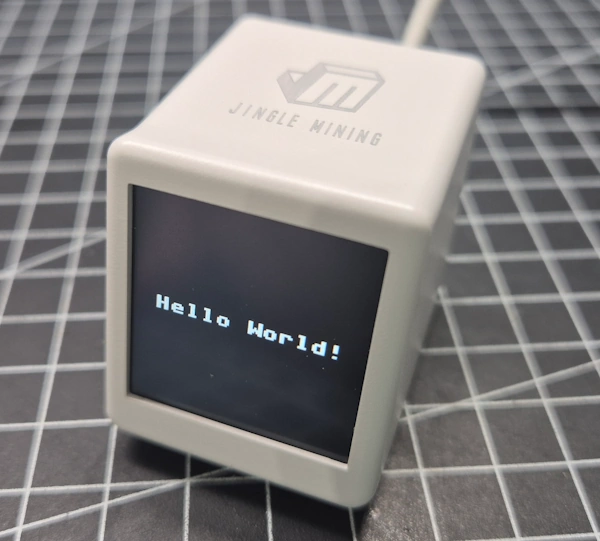
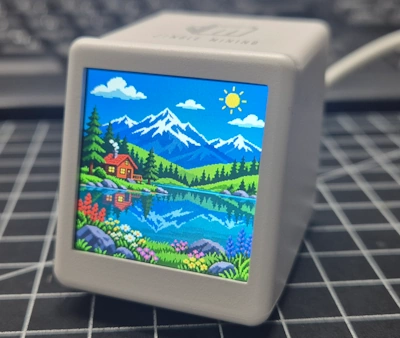
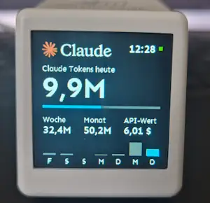

# GeekMagic SmallTV mit MicroPython

Eigene Inhalte auf dem Mini-Display: Dieses Repository sammelt MicroPython-Beispiele für den GeekMagic SmallTV mit ESP8266 und einem 240 × 240 Pixel großen ST7789-Farbdisplay. Die Beispiele führen von einer ersten Textausgabe über Bilder bis zu einem Claude-Code-Tokenmonitor mit PC-Bridge.

Die Anleitungen zum Projekt findest du auf [draeger-it.blog](https://draeger-it.blog).

## Beispiele im Überblick

| Beispiel | Beschreibung | Verzeichnis |
| --- | --- | --- |
| Hello World | Erste Textausgabe auf dem Display | [01_helloWorld](./01_helloWorld/) |
| Bilder anzeigen | RGB565-Bilddateien zeilenweise auf das Display übertragen | [02_images](./02_images/) |
| Claude-Code-Tokenmonitor | Lokal protokollierten Claude-Code-Verbrauch über eine PC-Bridge anzeigen | [03_ClaudeAI-Tokenmonitor](./03_ClaudeAI-Tokenmonitor/) |
| Displaytreiber | Gemeinsamer ST7789-Treiber für die Beispiele | [lib](./lib/) |

## 01 – Hello World

Die erste Textausgabe ist der Einstieg in die Displayansteuerung. Mit diesem Beispiel lässt sich prüfen, ob MicroPython, Displaytreiber und die gerätespezifische Displaykonfiguration zusammenspielen.

[Zum Hello-World-Beispiel](./01_helloWorld/)

## 02 – Bilder im RGB565-Format

Ein am Computer vorbereitetes Bild wird als RGB565-Rohdatei auf dem SmallTV angezeigt. Das Format enthält bereits die fertigen Pixeldaten. Dadurch muss der ESP8266 weder PNG noch JPEG dekodieren.

Die Bilddatei benötigt folgende Eigenschaften:

- Genau **240 × 240 Pixel**.
- **RGB565** mit zwei Byte pro Pixel.
- **Big Endian**, höherwertiges Byte zuerst.
- Pixel zeilenweise von links nach rechts und oben nach unten.
- Kein Dateikopf und keine Kompression.
- Genau **115.200 Byte** Dateigröße.

Das Beispiel liest die Bilddaten zeilenweise. Hinweise zur Vorbereitung und zur Konvertierung mit KI-Unterstützung stehen in der [README zum Bildbeispiel](./02_images/README.md).

[Zum Bildbeispiel](./02_images/)

## 03 – Claude-Code-Tokenmonitor

Der Tokenmonitor bringt den erfassten Claude-Code-Verbrauch auf ein eigenes Display am Schreibtisch. Eine Python-Bridge läuft auf dem PC, wertet lokale Protokolldateien aus und stellt die Ergebnisse als JSON über HTTP bereit. Der SmallTV ruft die Werte im WLAN ab und stellt sie als Dashboard dar.

Die Bridge liefert unter anderem:

- Tages-, Wochen- und Monatsverbrauch.
- Eingabe-, Ausgabe- und Cache-Token für heute.
- Tageswerte der letzten sieben Kalendertage.
- Einen anhand hinterlegter Modellpreise geschätzten API-Vergleichswert.

**Der Monitor erfasst die auf dem PC vorhandenen Claude-Code-Protokolle.** Claude-Webchat, Smartphone-App und andere Computer werden nicht automatisch einbezogen. Der API-Vergleichswert ist eine Schätzung und keine Abrechnung eines Claude-Abonnements.

Für neue Werte müssen der PC und die Bridge laufen und vom SmallTV erreichbar sein. Die Bridge benötigt Python 3.9 oder neuer, verwendet ausschließlich die Standardbibliothek und erfordert keinen API-Schlüssel.

Die Startbefehle, die JSON-Felder und die Einrichtung sind in der [README zum Tokenmonitor](./03_ClaudeAI-Tokenmonitor/README.md) beschrieben.

[Zum Tokenmonitor](./03_ClaudeAI-Tokenmonitor/)

## Hardware und Voraussetzungen

Die Beispiele beziehen sich auf den im Projekt verwendeten SmallTV-Aufbau mit:

- **ESP8266EX** und 4 MB Flashspeicher.
- **240 × 240 Pixel** großem Farbdisplay mit ST7789-Ansteuerung.
- Installierter MicroPython-Firmware.
- Passendem Displaytreiber und der Hardwarekonfiguration des jeweiligen Beispiels.

Der verwendete Jingle Mining CryptoTracker besitzt einen CH340 als USB-Seriell-Wandler und lässt sich darüber am Computer programmieren. Ein USB-C-Anschluss allein garantiert bei anderen SmallTV-Ausführungen keine serielle Datenverbindung.

Prüfe vor dem Übertragen von Firmware die tatsächliche Hardware deines Geräts. Das **SmallTV Pro verwendet einen ESP32** und benötigt eine dazu passende Firmware und Konfiguration.

## Einstieg

1. Sichere die Originalfirmware deines Geräts, bevor du sie ersetzt.
2. Installiere die zum Mikrocontroller passende MicroPython-Firmware.
3. Verbinde den SmallTV mit einer MicroPython-Entwicklungsumgebung, beispielsweise Thonny.
4. Übertrage `lib/st7789py.py` nach `/lib/st7789py.py` auf dem Gerät.
5. Beginne mit [01_helloWorld](./01_helloWorld/), um die Displayausgabe zu prüfen.
6. Übertrage anschließend die Dateien des gewünschten Beispiels und passe dessen Konfiguration an.

Die Vorbereitung des Geräts vom Firmware-Backup bis zur ersten Ausgabe beschreibt der Blogbeitrag [GeekMagic SmallTV umprogrammieren: Originalfirmware sichern und MicroPython installieren](https://draeger-it.blog/geekmagic-smalltv-micropython/).

Die Verzeichnisse dieses Repositorys strukturieren die Beispiele auf dem Computer. Auf dem SmallTV müssen die Dateien an den im jeweiligen Beispiel beschriebenen Zielorten liegen. Übertrage die Beispiele einzeln und sichere eine vorhandene `main.py`, bevor du sie durch ein anderes Beispiel ersetzt.

Persönliche WLAN-Zugangsdaten gehören nur in deine lokale Konfiguration. Ersetze sie vor einem Git-Commit durch Platzhalter.

## Verzeichnisse

| Verzeichnis | Inhalt |
| --- | --- |
| [`01_helloWorld/`](./01_helloWorld/) | Beispiel für die erste Textausgabe |
| [`02_images/`](./02_images/) | Beispiel für die Anzeige von RGB565-Bildern |
| [`03_ClaudeAI-Tokenmonitor/`](./03_ClaudeAI-Tokenmonitor/) | Claude-Code-Tokenmonitor mit PC-Bridge |
| [`lib/`](./lib/) | Displaytreiber und zugehörige Dokumentation |
| [`images/`](./images/) | Vorschaubilder für diese README |

## Displaytreiber und Quellen

Die Datei `st7789py.py` stammt aus [russhughes/st7789py_mpy](https://github.com/russhughes/st7789py_mpy). Dieses Projekt basiert auf dem ursprünglichen Treiber von [devbis](https://github.com/devbis/st7789py_mpy).

Verwende die zu den Beispielen passende Treiberdatei. Gleichnamige Dateien aus verschiedenen Forks können sich in ihrer Schnittstelle unterscheiden. Weitere Hinweise zu Installation, Import und Lizenz findest du in der [README des Ordners lib](./lib/README.md).

Der eingebundene Treiber steht unter der MIT-Lizenz des Originalprojekts. Die im Quellcode enthaltenen Lizenz- und Copyright-Hinweise müssen bei einer Weitergabe erhalten bleiben. Diese Angabe bezieht sich auf den Fremdtreiber; sie legt keine Lizenz für die übrigen Inhalte dieses Repositorys fest.

## Autor und Projekt

**Stefan Draeger** · [draeger-it.blog](https://draeger-it.blog)

[Repository auf GitHub](https://github.com/StefanDraeger/GeekMagicSmallTV-MicroPython)
